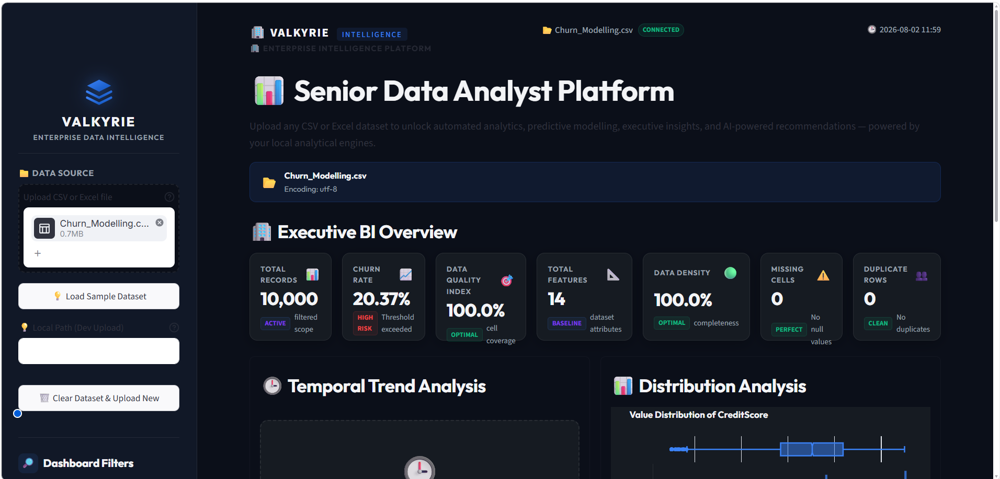
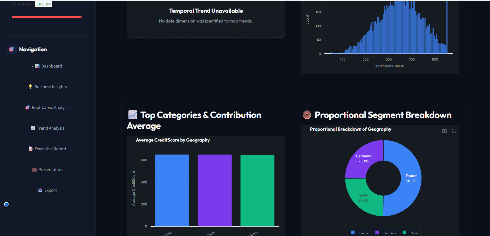
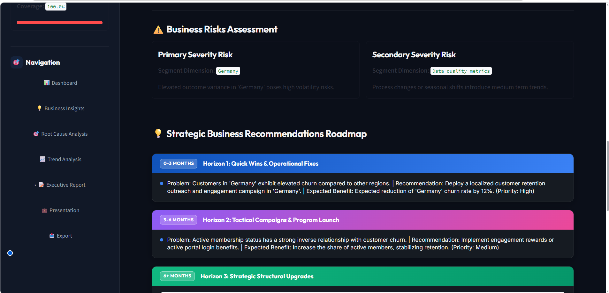
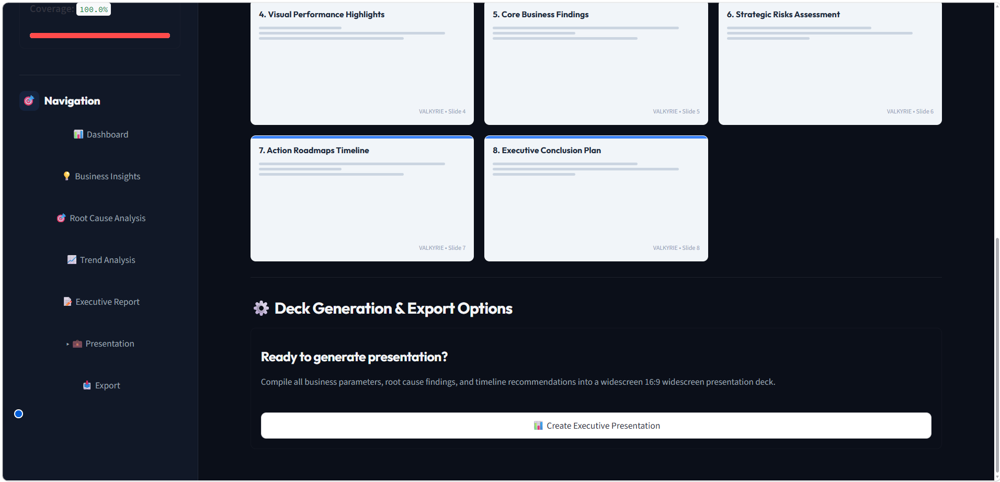

# AI Data Analytics Platform — Customer Churn Analysis

An AI-powered data analyst in a web app: upload any CSV or Excel dataset and it cleans it, profiles it, builds the dashboard, explains what the numbers mean, and turns the findings into an executive report and a presentation — in one click. Ask it a question about your data in plain English ("why did sales drop?") and the built-in chart chatbot answers from the dataset itself.

Built with Python, Streamlit, Pandas, Plotly, scikit-learn, and Google Gemini.



## What it does

Upload a dataset — no code, no setup per file — and the platform runs the full analyst workflow for you:

1. **Ingest & clean** — loads CSV and Excel files, validates the format, and checks for empty or corrupted data
2. **Profile the data** — row and column counts, duplicate rows, missing cells, data density, and a column-by-column dtype, missing-value, and uniqueness breakdown
3. **Build the dashboard** — KPI cards, distribution charts, segment breakdowns, and trend analysis, with filters for any column
4. **Explain the findings** — root-cause analysis, business risks, and prioritised recommendations on a 0–3 / 3–6 / 6+ month roadmap
5. **Answer questions** — the chart chatbot explains your dataset in plain language: what happened, why, and when
6. **Export the story** — a full executive report and a 16:9 PowerPoint deck, generated with a single click

## Demo: customer churn analysis

The screenshots below show the platform analysing `Churn_Modelling.csv` — 10,000 customer records, 14 features:


- **Total records: 10,000** · **Churn rate: 20.37%** (flagged high risk) · **Data quality index: 100.0%** · **Total features: 14**
- **Data density: 100.0%** · **Missing cells: 0** · **Duplicate rows: 0**
- CreditScore distribution, average CreditScore by geography, and a proportional breakdown of customers by geography



- **Geography split:** France 50.1% · Germany 25.1% · Spain 24.8%
- Average CreditScore is near-identical across the three regions (~650), so geography alone does not explain churn — the platform's root-cause analysis looks deeper, at membership, balance, and activity
- Temporal trend analysis is shown as unavailable when a dataset has no date dimension — the platform says so plainly instead of inventing a trend



- **Primary risk:** customers in Germany show elevated churn compared with other regions — the platform recommends a localised retention outreach and engagement campaign, with an expected 12% reduction in Germany's churn rate (high priority, 0–3 months)
- **Secondary risk:** active membership status has a strong inverse relationship with churn — engagement rewards and active-portal benefits are recommended to grow the share of active members (medium priority, 3–6 months)



- The platform compiles the findings into an 8-slide executive deck — visual highlights, core business findings, strategic risks, action roadmap timeline, and executive conclusion — ready to present

## Tech stack

| Area | Tools |
| --- | --- |
| App & UI | Streamlit, Plotly |
| Data | Pandas, NumPy, openpyxl |
| Modelling | scikit-learn |
| AI explanations | Google Gemini (`google-generativeai`) |
| Presentation export | python-pptx |
| Testing | pytest |

## How to run it

```bash
git clone https://github.com/dineshkarthik14322/ai-data-analytics-platform.git
cd ai-data-analytics-platform
pip install -r requirements.txt
cp .env.example .env   # add your own Gemini API key
streamlit run app.py
```

Then open http://localhost:8501, upload a CSV or Excel file, and explore the Dashboard, Business Insights, Root Cause Analysis, Trend Analysis, Executive Report, and Presentation pages. Or click **Load Sample Dataset** to try it instantly.

To generate the built-in test datasets (sales, HR, e-commerce, and banking — each with missing values, duplicates, and outliers injected on purpose):

```bash
python generate_test_data.py
```

To run the test suite:

```bash
pytest
```

## Files

| File | Description |
| --- | --- |
| `app.py` | Streamlit application — dashboard, insights, root-cause analysis, chatbot, report, and one-click PowerPoint export |
| `logger_setup.py` | Central logging configuration (console + `logs/app.log`) |
| `generate_test_data.py` | Generates 4 realistic test datasets with known data-quality issues |
| `requirements.txt` | Python dependencies |
| `.env.example` | Template for your Gemini API key — never commit a real key |
| `dashboard-overview.png` | Executive BI overview on the churn dataset |
| `distribution-geography.png` | Distribution and geography breakdown |
| `risks-roadmap.png` | Business risks and recommendations roadmap |
| `presentation-deck.png` | One-click executive presentation |

## About me

**Dinesh Karthik** — Aspiring Data Analyst | SQL · Power BI · Python · Excel

Final-year B.Tech Computer Science student, graduating 2027, seeking entry-level Data Analyst roles in India.

- LinkedIn: https://www.linkedin.com/in/dinesh-karthik-732a882bb/
- Portfolio: https://portfilo-lime-two.vercel.app/
- GitHub: https://github.com/dineshkarthik14322
